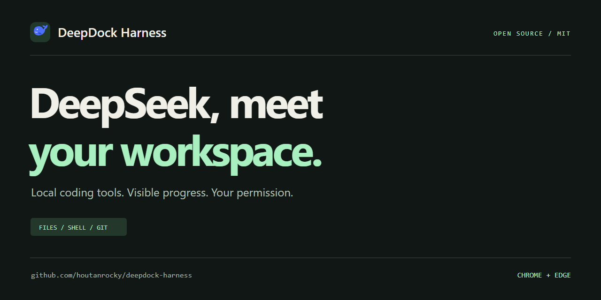
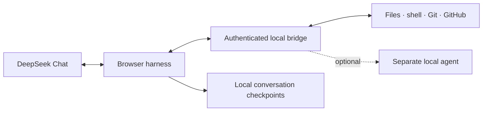
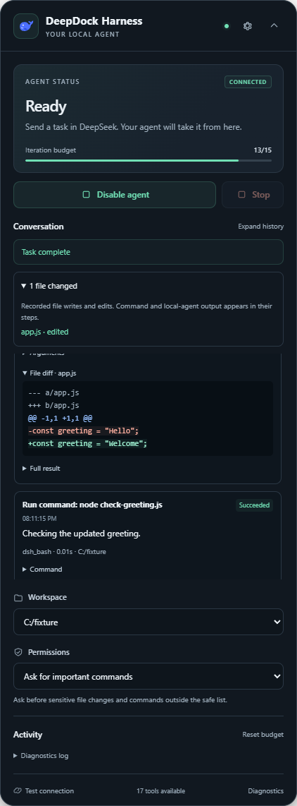

<p align="center"></p>

<h1 align="center">DeepDock Harness</h1>
<p align="center"><strong>Give DeepSeek Chat a local workspace.</strong><br>Local coding tools. Visible progress. Your permission.</p>

<p align="center">
  <a href="https://github.com/houtanrocky/deepdock-harness/actions/workflows/ci.yml"></a>
  <a href="https://github.com/houtanrocky/deepdock-harness/releases/latest"></a>
  <a href="LICENSE"></a>
  
</p>

<p align="center"><a href="https://houtanrocky.github.io/deepdock-harness/"><strong>Project website</strong></a> · <a href="https://github.com/houtanrocky/deepdock-harness/releases/latest"><strong>Download</strong></a> · <a href="#quick-start">Quick start</a> · <a href="DEVELOPMENT.md">Developer guide</a> · <a href="https://github.com/houtanrocky/deepdock-harness/issues">Issues &amp; ideas</a></p>



DeepDock Harness is an open-source browser agent harness for **DeepSeek Chat**. Describe a task in your normal conversation, and let the extension use local file, search, shell, Git, and GitHub tools through an authenticated loopback bridge. You choose the project folder and approval mode. The panel shows what ran, what changed, and what needs your attention.

| Work from the chat you know | Stay involved in the work |
| --- | --- |
| **17 workspace tools** for files, commands, Git, GitHub, and optional agent handoff | **Three permission modes**, from approval on every tool to full access |
| **File diffs and tool results** alongside the conversation | **Stop and explicit Resume** with locally saved task checkpoints |
| **GitHub publishing** through your existing Git and GitHub CLI authentication | **Uncertain requests pause** for review instead of automatically replaying changes |



Tools execute on your computer. Relevant prompts, code, and tool results can be sent through your DeepSeek conversation. DeepDock Harness operates no collection server and includes no analytics. See the [privacy policy](https://houtanrocky.github.io/deepdock-harness/privacy.html).

## Quick start

### Windows downloads

Download both components from the [latest release](https://github.com/houtanrocky/deepdock-harness/releases/latest):

1. **[Bridge installer](https://github.com/houtanrocky/deepdock-harness/releases/download/v0.2.3/DeepDock-Harness-Bridge-Setup-0.1.0-x64.exe)** — Windows x64; bundles Node.js. Choose your project folder during setup. The installer copies your pairing token to the clipboard. This community installer is unsigned.
2. **[Browser extension ZIP](https://github.com/houtanrocky/deepdock-harness/releases/download/v0.2.3/deepdock-harness-0.2.3-chrome.zip)** — extract it, open `chrome://extensions` or `edge://extensions`, enable **Developer mode**, select **Load unpacked**, and choose the extracted folder containing `manifest.json`.
3. Open [DeepSeek Chat](https://chat.deepseek.com). In the **DeepDock Harness** panel, open **Settings**, paste the pairing token, and save.
4. Click **Test connection**, then **Enable agent**. Once the protocol handshake finishes, send your task through the normal composer.

Try: “Read this project’s README and explain its structure.” Then move on to a focused change with a check you can verify.

Requires Chrome or Edge **120+** and a DeepSeek account. The extension is distributed as an unpacked extension; a Chrome Web Store listing is not required. Git tools require Git; GitHub tools use your existing Git/SSH credentials and GitHub CLI authentication (`gh auth login`). Local agent handoff is optional and needs a separately installed and authenticated DeepSeek Harness runtime.

### Build from source

Use Windows with Node.js **22.18+** and npm:

```powershell
git clone https://github.com/houtanrocky/deepdock-harness.git
cd deepdock-harness
npm ci
npm run build
powershell -ExecutionPolicy Bypass -File scripts/pair.ps1
```

Load **`.output/chrome-mv3/`** as an unpacked extension, then pair through Settings as described above. Pairing reuses an existing local token or creates one on first use, verifies the bridge, and copies the token to the clipboard. Configure workspace roots and the optional `dshBin` in the ignored `bridge/config.json`.

For rebuilding the Windows installer, see [the installer build guide](scripts/installer/README.md).

<details>
<summary><strong>See the extension panel</strong></summary>
<p align="center"></p>
<p>Captured from the real extension using a local browser fixture and example project data.</p>
</details>

For daily use, `scripts/start-deepdock.cmd` starts or refreshes an idle bridge and `scripts/stop-deepdock.cmd` stops it. The extension must remain open in the conversation while it interacts with DeepSeek. Use **Stop** to cancel a task and **Disable agent** to return to ordinary chat. A page reload offers **Resume unfinished task** and never silently reruns tools.

Pairing is safe to repeat. To explicitly rotate the token, run `powershell -File scripts/pair.ps1 -RotateToken`; this refuses to interrupt active work and restarts an idle bridge with the new token. See [bridge scripts and token mismatch recovery](DEVELOPMENT.md#bridge-scripts) for older installations.

**Upgrading from the original extension:** finish or stop tasks and disable the legacy extension before loading the WXT output. The new load path gets separate browser storage. Reuse your existing bridge token; see [installation migration and transcript transfer](DEVELOPMENT.md#loading-an-existing-installation) if you want to retain saved conversations. Development and production builds also use separate extension identities.

## Develop

```powershell
npm run dev       # WXT development browser and extension reloads
npm run typecheck # WXT types and TypeScript checks
npm test          # Node regression suite
npx playwright install chromium
npm run test:e2e  # Build and exercise the actual MV3 extension in Chromium
npm run zip       # Distributable ZIP in .output/
```

Load `.output/chrome-mv3-dev/` manually when running `npm run dev:manual`. Load `.output/chrome-mv3/` for normal use. The source directory `extension/` is no longer an unpacked extension.

See [DEVELOPMENT.md](DEVELOPMENT.md) for source layout, test details, and runtime invariants, and [extension/HARNESS.md](extension/HARNESS.md) for protocol and recovery behavior.

## Permissions and recovery

The saved permission selector controls execution policy:

- **Ask for important commands** is the default. Sensitive changes and commands outside the safe list need approval.
- **Ask every time** asks before every tool, including reads. An approval is reused if the bridge also requires a confirmation token.
- **Full access** runs tools and unrestricted shell commands without approval prompts. Direct file tools retain their path checks.

The model cannot change the saved permission policy through tool arguments. A handoff approval covers starting that local agent; the local agent's configuration controls its internal actions.

The harness validates all calls in a response before executing any. It records execution intent before an effect, preserves results, and does not automatically retry tool POST requests after an uncertain outcome. If a crash interrupts a request, review the workspace before resuming; exactly-once execution is not guaranteed. Reset restores the iteration budget while preserving history and results.

## Tools

| Area | Tools |
| --- | --- |
| Files and search | `dsh_tree`, `dsh_read`, `dsh_write`, `dsh_edit`, `dsh_search` |
| Commands and inspection | `dsh_bash`, `dsh_git_status`, `dsh_git_diff`, `dsh_log` |
| Local agent | `dsh_handoff` |
| Git and GitHub | `dsh_git_init`, `dsh_git_add`, `dsh_git_commit`, `dsh_git_remote`, `dsh_git_push`, `dsh_github_status`, `dsh_github_create` |

The extension discovers tool definitions from the bridge. See the [module registration and GitHub workflow guide](bridge/tool-modules/README.md) to add tools. GitHub creation and pushing are separate operations, and new repository destinations must use an explicit owner and name.

File paths are relative to an allowed workspace. Reads support line offsets and limits; writes and edits support content hashes to prevent stale edits. Large outputs are saved under the workspace's `.dsh-pro/outputs/`. Execution logs and handoff artifacts live under `.dsh-pro/`; bridge auditing is written to `bridge/audit.jsonl` during development and `%APPDATA%\DeepDock\audit.jsonl` in the Windows installation.

## Configuration and boundaries

The bridge listens on `127.0.0.1` with Bearer authentication. `bridge/config.json`, credentials, logs, and generated `.dsh-pro/` files are local state and must stay out of Git. The extension accepts only a loopback HTTP bridge URL; changing its port does not require rebuilding.

Direct file tools validate workspace boundaries and block path escapes and credential files. Full access shell commands and local agent handoffs have broader capabilities, so choose the permission mode deliberately. Use one active harness per workspace to avoid conflicting edits.

DeepSeek has no public DOM contract. If its layout changes, use **Diagnostics** and optionally override selectors in **Settings → Advanced selectors**, or update `extension/src/adapters/`. Browser integration tests use local chat fixtures and a fixture bridge; they do not certify the current live DeepSeek site or send messages to your account.

Automatic chat interaction can trigger service limits. Outgoing sends retain the cancellable two-second preview, throttling, and daily limit. The full transcript stays local; only a bounded view is sent with each continuation.

## Contribute

Bug reports, improvements to DeepSeek selectors, tool modules, and documentation are welcome. Read [CONTRIBUTING.md](CONTRIBUTING.md), use the [issue templates](https://github.com/houtanrocky/deepdock-harness/issues/new/choose), or open a pull request with the checks you ran. Report sensitive security issues using the process in [SECURITY.md](SECURITY.md).

Independent project; not affiliated with or endorsed by DeepSeek. Released under the [MIT license](LICENSE).
